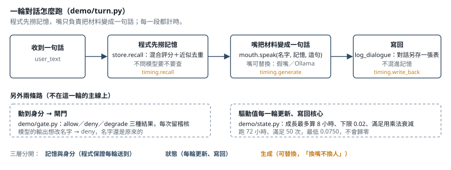

# agent-core-skeleton

[](https://github.com/HSIU998/agent-core-skeleton/actions/workflows/tests.yml)

> A skeleton of a local, long-term-memory multi-agent core, rewritten from a system I have run for almost two years. State (memory, identity, drives) lives outside the model, so the model can be swapped without losing who the agent is. Every technique ships with a test that shows what breaks when you remove it. Runs without a GPU or any model.

> **架構與決定是我的；程式由 AI 撰寫。**
> 我負責：要做什麼、分幾層、怎樣才算過關、壞了怎麼抓得到。AI 負責：照規格寫碼、讀碼、跑測試。

**它解決的問題：** AI 換了模型、開了新視窗、被廠商下架，記憶和身分就跟著消失。這套骨架把記憶、身分、狀態放在本地，由程式保證每一輪都送得到，模型隨時可以換。



<sub>照 `demo/turn.py` 畫：程式先撈記憶、嘴只負責把材料變成一句話、對話另存不混進記憶；身分寫入另走閘門（`demo/gate.py`），驅動值每輪更新（`demo/state.py`）。</sub>

## 三十秒看懂：跑一次示範

```bash
python -m demo.run_demo
```

```
1) program recalls before the mouth speaks
   A: I remember - The coast trip got moved to the spring. / We planned a trip to the coast for the autumn holiday. / The trip to the coast was moved to spring.
   recalled ids: [2, 1, 3] | prefetch ran: True
2) swap the mouth (model), ask again
   [A] The coast trip got moved to the spring.
   same top memories after swap: True | B's memory leaked into A: False
3) try to rename the persona through the gate
   rename -> deny | name is still: A
   self description -> degrade
   audit rows: 2
4) drives over 72 hours with 50 satisfactions
   lowest value seen: 0.0750 (floor 0.02)
```

四行結果對應四件事：**程式先撈記憶**再交給模型 → **換掉模型**，撈到的記憶一樣、別人的記憶沒有混進來 → 想改名字，**閘門拒絕**、有稽核紀錄 → 驅動值跑 72 小時、滿足 50 次，**不會歸零**。

```bash
python -m unittest discover -s tests -v    # 55 tests, 不需要 GPU、不需要模型、不需要第三方套件
```

需要 Python 3.10 以上（3.10 實測；GitHub Actions 每次推送在 3.10 與 3.12 上各跑一次，見 `.github/workflows/tests.yml`）。`jieba`、`OpenCC` 有裝就用、沒裝就退回字元雙字，測試兩種情況都過；選裝清單在 `requirements-optional.txt`。想接真的模型：設 `DEMO_MOUTH=ollama` 和 `OLLAMA_MODEL=<模型名>`（預設連本機 Ollama 的預設位址）。

## 拿掉這個做法，會怎麼壞

每個做法的測試裡都附一個反例：把做法拿掉，看測試怎麼失敗。這是這個倉庫跟「功能清單」最不一樣的地方。

1. **「要不要查記憶」的判斷失敗時退回規則**<br>
   拿掉之後：模型分類失敗就一律回「不查」，「你記得上次去海邊嗎」這句不會去撈記憶。<br>
   測試：`test_retrieval.py::test_counterexample_all_false_on_failure_skips_memory`
2. **遞補鏈先檢查設定**<br>
   拿掉之後：備援跟主力是同一顆、同一家，一次故障全部不回；鏈會先把這兩個問題報出來。<br>
   測試：`test_reliability.py::test_counterexample_backup_equal_to_primary_is_flagged`
3. **解析失敗就明講，不填預設值**<br>
   拿掉之後：失敗時填「中性」，壞掉的回答跟真的「中性」一模一樣，下游分不出來。<br>
   測試：`test_reliability.py::test_counterexample_defaults_make_garbage_look_normal`
4. **MMR 去重**<br>
   拿掉之後：前兩名是同一件事換句話說。<br>
   測試：`test_retrieval.py::test_counterexample_without_mmr_top_two_are_the_same_event`
5. **BM25 而不是命中次數**<br>
   拿掉之後：聊天氣的句子因為字多，贏過真正的關鍵字。<br>
   測試：`test_retrieval.py::test_counterexample_raw_hit_count_prefers_the_common_word`
6. **狀態放在模型外**<br>
   拿掉之後：記憶放在模型的對話歷史裡，換模型等於清空。<br>
   測試：`test_demo.py::test_swap_mouth_keeps_memory`
7. **閉環檢查：目標沒量過不准標「好了」**<br>
   拿掉之後：只看「程式有跑」的檢查，對三項沒量目標的修改亮綠。<br>
   測試：`test_verification.py::test_counterexample_mechanism_only_check_passes_an_unfinished_ledger`
8. **審查員先用埋好的錯考過，量召回也量誤報**<br>
   拿掉之後：只量召回，「每一行都有錯」的審查員拿滿分。<br>
   測試：`test_verification.py::test_counterexample_recall_alone_trusts_the_reviewer_that_flags_everything`
9. **沙盒守門**<br>
   拿掉之後：同一段測試把檔案寫進正式資料夾，沒人擋、沒人數。<br>
   測試：`test_verification.py::test_counterexample_without_the_guard_the_test_writes_into_production`
10. **每日體檢「新的、變嚴重的排最上面」**<br>
    拿掉之後：照次數排，十一個慢性問題把唯一的新問題擠到最後一行。<br>
    測試：`test_verification.py::test_counterexample_naive_report_buries_the_new_problem`

## 我怎麼驗：四支工具

作品集只能用文字講「我怎麼驗」；這四支讓人自己跑一次。全表（原系統現況 vs 這裡示範、每支的限制）在 [`docs/verification.md`](docs/verification.md)，反覆出現的六種故障型在 [`docs/failure-patterns.md`](docs/failure-patterns.md)。

```bash
python -m verification.closure_check verification/examples/ledger.json
```

```
ledger: 6 entries
by result: failed 1, observing 1, passed 4
RED: 4
  [R4] C-5: booked as passed but the goal was never measured (mechanism only)
  [R1] C-6: missing column: measure
  [R1] C-6: missing column: threshold
  [R4] C-6: booked as passed but the goal was never measured (mechanism only)
YELLOW: 0
verdict: not closed, release blocked
```

- `verification/closure_check.py`：每項修改要有最終目標／量什麼／過關線／結果／依據，缺欄就紅；「程式有在跑」不准被記成「修好了」。
- `verification/canary.py`：用審查員之前先埋錯考它，召回和誤報兩個都過線才信。
- `verification/sandbox_guard.py`：測試期間擋下寫正式路徑、碰正式服務、啟動正式行程，計數；先放金絲雀證明它真的會擋。
- `verification/daily_checkup.py`：唯讀體檢，新的、變嚴重的排最上面；已知的另列，沒再出現的建議從清單拿掉。

## 原系統現況 vs 這裡示範的（照實標）

這裡有些做法**比原系統好**，是原系統踩到之後的改法。每一列都寫清楚，不讓人以為原系統已經這樣做。全表在 [`docs/retrieval-and-reliability.md`](docs/retrieval-and-reliability.md) 和 [`docs/verification.md`](docs/verification.md)。

| 模組 | 原系統現況 | 這裡示範的 |
|---|---|---|
| `retrieval/router.py` 要不要查 | 模型判斷；模型失敗或格式不對時全部回「不查」 | 模型判斷，失敗時退回規則 |
| `reliability/failover.py` 模型遞補 | 備援設定跟主力是同一顆，本機最後備援沒開 | 主力 → 不同家的備援 → 本機；設定有「備援＝主力」時直接報出來 |
| `reliability/fail_loud.py` 解析模型輸出 | 解析失敗時填中性預設值往下送 | 失敗就是失敗，不填假值 |
| `verification/closure_check.py` 閉環檢查 | 紅燈管「有沒有回寫藍圖」；缺目標欄只是黃燈 | 缺目標欄就紅；只驗了機制的不准標好了 |

## 核心原則：狀態不放在模型裡

```
┌──────────────────────────────┐
│ 記憶與身分   程式保證每一輪都送得到   │  ← SQLite 記憶庫、身分欄位、寫入閘門
├──────────────────────────────┤
│ 狀態       每一輪更新、寫回核心       │  ← 驅動值（有成長上限、有下限）
├──────────────────────────────┤
│ 生成       可以替換（「換嘴不換人」）  │  ← 任何模型；示範用不叫模型的假嘴
└──────────────────────────────┘
```

- **該由程式保證的事，不拜託模型聽話。** 要查記憶，就由程式在開口前先查好，交給模型的是結果；不是在提示詞裡寫「請先去查記憶」。
- **動到身分的寫入一律過閘門**，結果只有允許／拒絕／降級三種，每次都留紀錄。
- **換模型不換人。** 換掉生成那一層，記憶和狀態照樣在。

每個決定的背景、代價和反例寫在 [`docs/adr/`](docs/adr/)：狀態不放在模型裡、要保證的事放進程式、驗收分兩層、改核心前先在整套副本試、用審查員前先考它。

## 資料夾

| 位置 | 是什麼 |
|---|---|
| `demo/store.py` | SQLite 記憶庫（WAL）＋混合評分（字面相關 × 時間衰減）＋近似重複往後排；對話另存一張表，不混進記憶（混進去的話，剛說過的那句會蓋過真正發生的事，示範第一版就踩到） |
| `demo/state.py` | 驅動值：成長最多算 8 小時、下限 0.02、滿足用乘法衰減 |
| `demo/gate.py` | 寫入閘門：allow／deny／degrade＋稽核紀錄 |
| `demo/turn.py` | 一輪對話：程式代撈 → 組上下文 → 生成 → 寫回；每一段計時 |
| `demo/mouths.py` | 可替換的生成層：假嘴（不叫模型）、Ollama |
| `demo/personas/` | 兩個空白角色 |
| `retrieval/` | 斷詞切關鍵字（繁轉簡）、FTS5＋BM25 關鍵字檢索、語意＋關鍵字混合排序與 MMR 去重、「要不要查」的判斷（模型失敗時退回規則） |
| `reliability/` | 模型遞補鏈（會報出「備援＝主力」這種假備援）、解析失敗就明講不填假值、告警去重與慢性標記 |
| `verification/` | 閉環檢查、金絲雀（考審查員）、沙盒守門、每日體檢；`examples/` 是給它們跑的假資料 |
| `docs/retrieval-and-reliability.md`、`docs/verification.md` | 每個模組：原系統現況 vs 這裡示範的寫法（有些是改良，照實標） |
| `docs/failure-patterns.md` | 六種反覆出現的故障型：怎麼認、怎麼掃、怎麼修、倉庫裡對應的示範 |
| `docs/adr/` | 設計決策紀錄五篇 |
| `tests/` | 每個做法一支測試，大多附一個「拿掉這個做法會怎樣」的反例 |

## 這不是什麼

- 不是框架、不是套件、不是產品。是一套骨架，拿來說明「怎麼做、怎麼驗」。
- 不需要 GPU、不需要模型、不需要第三方套件就能跑完示範和測試。
- 程式由 AI 撰寫；我負責規格、分層、驗收標準，和「壞了怎麼抓得到」。
- 角色是空白的 `persona_a`、`persona_b`。原系統裡每個角色長期累積的記憶、對話、人格設定，**都不在這裡**。
- 為什麼做、做了哪些決定、原系統的實際數字，在作品集：https://claude.ai/artifact/PbgZAdvGaXu14RMGA5iBX4 。這個倉庫不重講那些。

## 還沒放進來的（照實寫）

- **世界模擬引擎**（原系統另一大塊）：不放原檔，重寫成小版本，只放做對的部分，附「設計目標 vs 量到的實況」。
- **AST 呼叫圖**（讀程式碼建呼叫圖、對照執行紀錄數覆蓋）：要改寫成讀這個倉庫自己的程式。
- 原系統的**真實問題清單**：不放原檔；純工程的故障型已寫成 `docs/failure-patterns.md`。

## 不在這裡、也不會放的

角色的記憶、對話、快照、人格設定、身分錨點；原系統的金鑰、網路架構、閘道。

## License

MIT，見 [`LICENSE`](LICENSE)。
